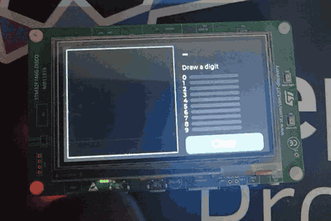
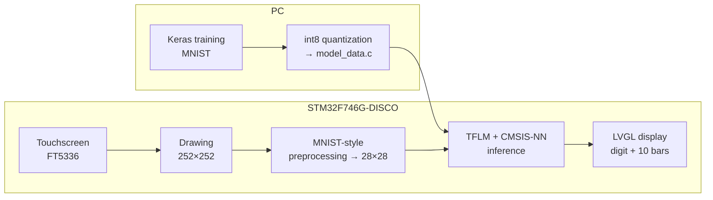

# Digit Touch

Handwritten digit recognition running entirely on a microcontroller. Draw a digit with your finger on the touchscreen of an **STM32F746G-DISCO**: a 32 KB int8 convolutional neural network recognizes it in about **6 ms** and shows the answer with a confidence bar for each of the 10 digits.

No PC, no cloud, no extra sensor: the screen is both the input and the output.

<p align="center"></p>

| | |
|---|---|
| Board | STM32F746G-DISCO (Cortex-M7 @ 216 MHz, 1 MB flash, 320 KB RAM, 4.3" 480×272 touchscreen) |
| Software | Zephyr RTOS, TensorFlow Lite Micro + CMSIS-NN, LVGL |
| Model | CNN, 26,698 parameters, int8, **32 KB** |
| Accuracy | **98.65 %** on the MNIST test set (int8) |
| Inference | **6.1 ms** on the board (117 ms without CMSIS-NN) |
| Drawing → result | **< 9 ms** (preprocessing + inference) |

## How it works



1. The model is trained on the PC with Keras, then quantized to int8 and exported as a C array compiled into the firmware.
2. On the board, the finger drawing is converted to a 28×28 image prepared exactly like MNIST digits.
3. TensorFlow Lite Micro runs the model, accelerated by ARM's CMSIS-NN kernels.
4. LVGL shows the recognized digit and the 10 confidence bars. Below 75 % confidence, the board shows **"?"** instead of a possibly wrong answer.

Recognition starts automatically 500 ms after the finger is lifted, so multi-stroke digits (a crossed 7, a 4 in two strokes) work. Touching the screen once a result has been shown for 1 s clears the drawing, so digits can be drawn one after another without pressing a button.

## The model

```
Input        28×28×1  (int8)
Conv2D       8 filters 3×3, same padding, ReLU   → 28×28×8      80 params
MaxPool 2×2                                      → 14×14×8
Conv2D       16 filters 3×3, same padding, ReLU  → 14×14×16  1,168 params
MaxPool 2×2                                      →  7×7×16
Flatten                                          → 784
Dense        32, ReLU                            → 32       25,120 params
Dense        10, Softmax                         → 10          330 params
```

- Trained in **38 s on a laptop CPU** (15 epochs, light data augmentation): **98.67 %** test accuracy.
- Only 5 operations on the board (`CONV_2D`, `MAX_POOL_2D`, `RESHAPE`, `FULLY_CONNECTED`, `SOFTMAX`), all accelerated by CMSIS-NN.
- The model is exported with a fixed batch size of 1. This removes three useless operations (`SHAPE`, `STRIDED_SLICE`, `PACK`) from the graph.

### int8 quantization

| Version | Size | MNIST test accuracy |
|---|---|---|
| float32 `.tflite` | 110 KB | 98.67 % |
| **int8 `.tflite`** | **32 KB** (÷ 3.4) | **98.65 %** |

Inputs, weights and outputs are all int8: there is no floating point left in the model. Because integer arithmetic is exact, the board reproduces the PC's outputs **byte for byte**. A startup self-test checks this on 12 MNIST images.

## Preprocessing: the part that matters most

The model has only seen MNIST digits, which are all prepared the same way. A finger drawing can be anywhere on the screen and of any size. Fed as is, it would fall outside what the model knows (domain shift). `src/preprocess.c` reproduces the MNIST preparation on the board:

1. Bounding box of the ink.
2. Square crop whose side is the longest side of the box, so a "1" stays thin instead of being stretched.
3. Downscale to 20×20, each pixel being the average of its cell. This gives MNIST's grey anti-aliased edges.
4. Placement in the 28×28 image so that the ink's **center of mass** is at the center.

On 45 test drawings, the board and the PC gave the same prediction 45 times. For debugging, every drawing is also printed to the serial console as 28×28 ASCII art.

## Performance

Measured on the board, averaged over 100 inferences:

| Configuration | Inference time | Flash |
|---|---|---|
| `-Os`, reference kernels | 113 ms | 561 KB |
| **`-Os`, CMSIS-NN (default)** | **6.14 ms** | **599 KB** |
| `-O2`, CMSIS-NN | 6.08 ms | 726 KB |
| `-O2`, CMSIS-NN, tensor arena in DTCM | 6.05 ms | 726 KB |

- **CMSIS-NN is the optimization that matters: × 18**, for 38 KB of flash.
- With CMSIS-NN, `-O2` saves 1 % of time for 127 KB of extra flash, so the project keeps `-Os`.
- Tensor arena: 9,924 bytes used, 12 KB reserved. RAM usage of the whole application: 162 KB.

Where the flash goes (about 600 KB in total):

| Component | Size |
|---|---|
| LVGL (without fonts) | 293 KB |
| Montserrat 48 font | 95 KB |
| Other fonts (14, 24) | 44 KB |
| CMSIS-NN | 40 KB |
| Application code | 39 KB |
| TFLM | 38 KB |
| Zephyr + drivers | 36 KB |
| **Model** | **32 KB** |
| Self-test images | 9 KB |
| libc / libc++ | 8 KB |

The whole AI part (TFLM + CMSIS-NN + model) is about 110 KB, roughly 18 % of the flash. The graphical interface takes about 70 %. The large digit font alone weighs three times the model.

## Known limitations

- **The French "1"** (with a long upstroke) is often shown as "?" or read as 4 or 7. MNIST comes from American handwriting, where this stroke is rare. A plain "1" is recognized at over 99 %. This is a data bias, not a preprocessing bug.
- **Non-digits** still get a digit as an answer, sometimes with high confidence: the model only knows 10 classes.
- On real drawings, the 75 % threshold turns most hesitations into "?". In a 21-drawing session: 16 correct, 3 "?", 0 wrong answers shown as confident.

## Getting started

### Requirements

- A Zephyr workspace (tested with Zephyr 4.5.0-rc1) with the optional `tflite-micro` module:
  ```bash
  west config manifest.project-filter -- +tflite-micro
  west update tflite-micro
  ```
- An STM32F746G-DISCO board.

### Build and flash

Place this folder in your workspace (for example `applications/digit_touch`), then from it:

```bash
west build -p -b stm32f746g_disco . -d build -o=-j4
west flash -d build
```

`-o=-j4` limits parallel compile jobs. Without it, TFLM's build can run a machine with limited RAM out of memory.

Serial console: `/dev/ttyACM0`, 115200 baud. At every boot, the self-test prints the 12 predictions, the comparison with the PC, the inference time and the arena usage. Then, for each drawing, the console shows the 28×28 image, the top 3 predictions and the preprocessing and inference times.

### Retrain the model (optional)

The trained model is already included (`src/model_data.c`). To regenerate it, use a Python environment separate from Zephyr's:

```bash
python3 -m venv ~/venvs/tf
source ~/venvs/tf/bin/activate
pip install -r train/requirements.txt
cd train
python train.py           # trains the CNN       → out/model.keras, curves, confusion matrix
python quantize.py        # int8 + checks         → out/model_int8.tflite, src/model_data.c
python export_samples.py  # self-test images      → src/test_images.c
```

`python view_digits.py <serial_log>` reads the `IMG:` lines printed by the board and compares your drawings with real MNIST digits.

### Options

| Option | Effect |
|---|---|
| `CONFIG_TENSORFLOW_LITE_MICRO_CMSIS_NN_KERNELS` | CMSIS-NN kernels (on by default). Turn off to compare with the reference kernels. |
| `CONFIG_APP_ARENA_IN_DTCM` | Places the tensor arena in DTCM instead of SRAM. |
| `CONFIG_APP_LAYER_PROFILING` | Prints the time spent in each layer during the self-test. |
| `CONFIG_SPEED_OPTIMIZATIONS` | Builds with `-O2` instead of `-Os`. |

Example: `west build -p -b stm32f746g_disco . -d build_ref -o=-j4 -- -DCONFIG_TENSORFLOW_LITE_MICRO_CMSIS_NN_KERNELS=n`

## Project layout

```
digit_touch/
├── CMakeLists.txt, prj.conf, Kconfig
├── src/
│   ├── main.c            startup, drawing → preprocessing → inference → display
│   ├── ui.c              LVGL interface: drawing area, result, confidence bars
│   ├── preprocess.c      drawing → MNIST-style 28×28 int8 image
│   ├── inference.cc      TFLM wrapper (C API for the rest of the code)
│   ├── selftest.c        startup self-test against the PC's outputs
│   ├── model_data.c      int8 model as a C array (generated)
│   └── test_images.c     self-test images and expected outputs (generated)
├── train/                training, quantization and analysis scripts
└── demo/                 videos of the board
```

## Lessons learned

- **Thread priorities.** Touch points were lost right after debug images were sent to the serial console. The input thread and the log thread both had the lowest priority, so the input queue overflowed while logs were being sent. Raising the input thread priority (`CONFIG_INPUT_THREAD_PRIORITY=5`) fixed it: 0 points lost over 27 drawings, against 14 before.
- **The profiler changes what it measures.** Per-layer profiling made inference 22 % slower (7.48 ms instead of 6.14 ms). The profiler itself costs almost nothing, but the extra code moves functions around in flash, and the Cortex-M7 only has a 4 KB instruction cache. Use profiling for the proportions between layers, and measure absolute times without it.
- **Where CMSIS-NN helps most.** With reference kernels, time follows the number of multiplications: `conv2` takes about 70 %. With CMSIS-NN, `conv1` becomes the bottleneck (55 % of the time). It has a single input channel, so it benefits little from SIMD (× 7, against × 31 for `conv2`).

## Possible next steps

- Collect custom drawings and fine-tune the model, to learn the French "1".
- Port to the STM32H747I-DISCO (800×480 MIPI-DSI screen, 480 MHz) and try a larger model.
- Trim the large font to the characters actually used (about −90 KB of flash).

## License

Apache License 2.0, see [LICENSE](LICENSE).
